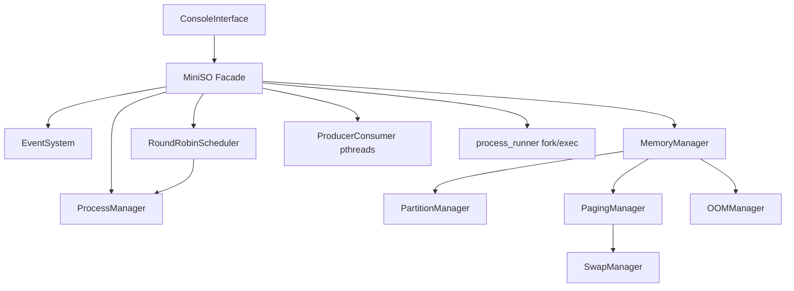

# Arquitectura MiniSO Lab (Fase 1)

## Arquitectura híbrida

El núcleo no depende de Qt. La consola y, más adelante, la GUI solo invocan la fachada `MiniSO`.

## Responsabilidades

| Componente | Responsabilidad |
|---|---|
| MiniSO | Orquesta arranque, creación/terminación, escenarios y cierre |
| ProcessManager | PID, PPID, BCP, transiciones, árbol, historial |
| RoundRobinScheduler | Cola READY, quantum, reloj simulado, hilo opcional |
| PartitionManager | First-Fit, división y coalescing |
| PagingManager | Marcos, tablas, traducción, FIFO, pines |
| SwapManager | Almacén simulado de páginas expulsadas |
| OOMManager | Selección de víctima simulada |
| ProducerConsumer | Hilos POSIX reales y búfer circular |
| ProcessRunner | Lanza el auxiliar Linux y parsea JSON |
| EventSystem | Publicación no bloqueante con capacidad limitada |

## Política de finalización

- Procesos de sistema: no se terminan con operaciones de usuario.
- Hijos: por defecto se reparentan a MiniKernel (PID 1).
- Cierre de aplicaciones: terminación en cascada.
- Un proceso terminado permanece en el historial.

## Reloj y GUI futura

Las pruebas y la consola avanzan el planificador con `schedulerTick()`. El hilo real del planificador existe para demostraciones, pero no debe usarse desde el hilo gráfico de Qt.
